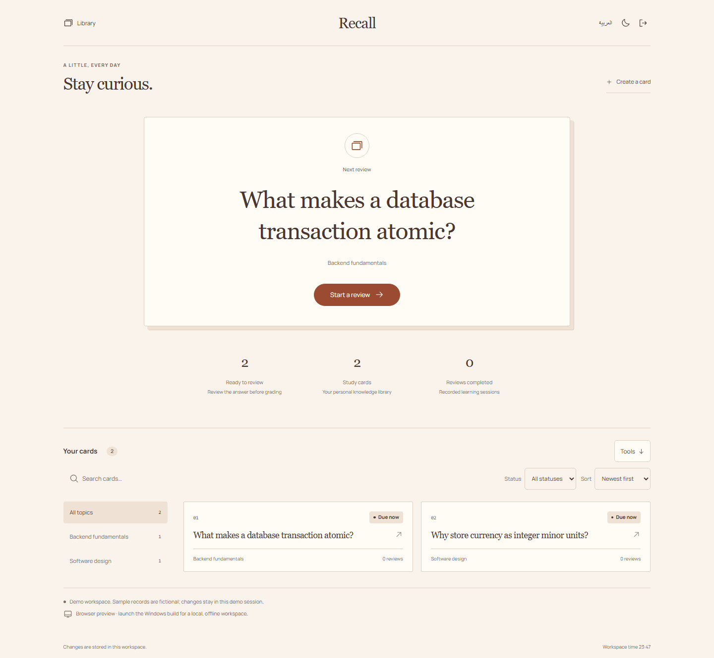
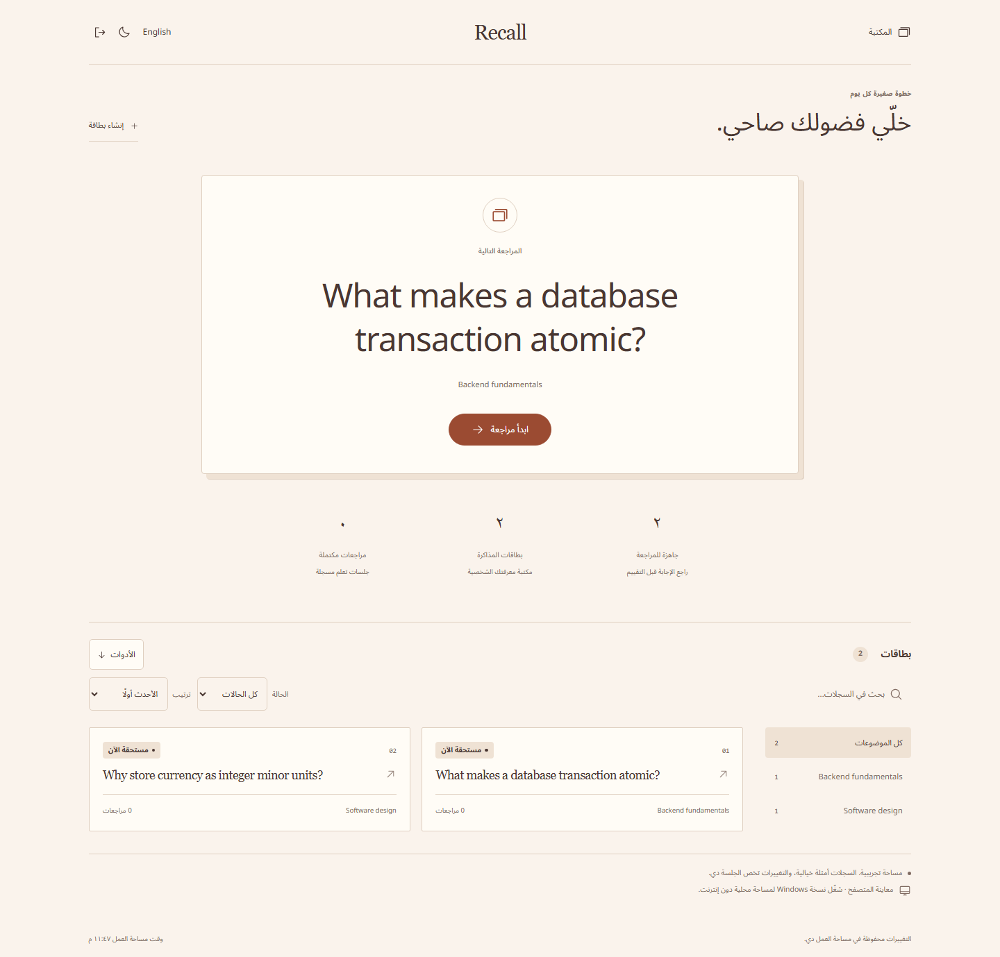
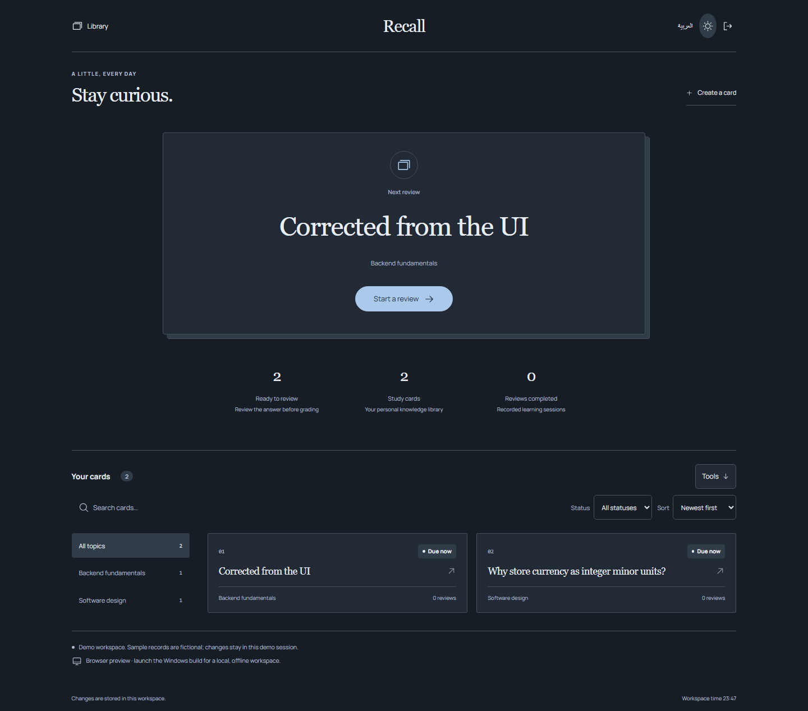

<div align="center">

<h1>Recall</h1>
<p><strong>A little practice. A better next review.</strong></p>
</div>

**Read the question → Recall the answer → Reveal → Rate → Return when due.**



**[Download for Windows](https://github.com/Ahmed-Khalil-Mohamed/recall/releases/latest)** · [العربية](#بالعربي) · [Report a bug](https://github.com/Ahmed-Khalil-Mohamed/recall/issues/new?template=bug_report.yml) · [Suggest an improvement](https://github.com/Ahmed-Khalil-Mohamed/recall/issues/new?template=feature_request.yml)

[](https://github.com/Ahmed-Khalil-Mohamed/recall/actions/workflows/quality.yml) [](LICENSE) 

## A study session with a clear stopping point

1. Create question/answer cards grouped by topic.
2. Start a due review, recall the answer, then reveal it.
3. Grade Again, Hard, Good or Easy. The next due date and review history update immediately.

## Get the Windows app

Download **[Recall-1.1.0-windows-x64.zip](https://github.com/Ahmed-Khalil-Mohamed/recall/releases/download/v1.1.0/Recall-1.1.0-windows-x64.zip)**, extract the entire folder, and open `Recall\Recall.exe`. Keep the accompanying files next to the executable. Node.js is bundled; installing Node is only necessary for development.

[SHA256SUMS.txt](https://github.com/Ahmed-Khalil-Mohamed/recall/releases/download/v1.1.0/SHA256SUMS.txt) is supplied with the release. This is an **unsigned portable Windows x64 build**, tested on the development Windows machine; compatibility with every Windows configuration is not certified. There is no installer or automatic updater. Data stays in `%APPDATA%\Recall\workspace.sqlite`, separately from the browser preview. Copying the app folder does not copy that database.

GitHub's automatic source archives contain the complete development source; use the Windows ZIP to run the packaged application.

## More of the interface

<details>
<summary>Arabic workspace / الواجهة العربية</summary>



</details>

<details>
<summary>Dark workspace</summary>



</details>

Centered serif brand, warm paper palette, a single large study prompt, understated progress below and a topic-filtered library at the bottom. No permanent dashboard rail.

Screenshots show the actual interface with fictional demonstration records. [Design notes](DESIGN.md) · [Image and icon provenance](ASSETS.md).

## Behind the workflow

- The scheduler is a transparent SM-2-inspired heuristic, not a validated learning-outcome claim.
- Again schedules ten minutes; initial Good schedules one day; initial Easy schedules four days.
- Future reviews are blocked by the domain layer; a double click cannot instantly repeat a saved review.

## Build the desktop app

Use **Node.js 24 or newer** and npm.

```sh
git clone https://github.com/Ahmed-Khalil-Mohamed/recall.git
cd recall
npm ci
npm run build
npm run desktop
```

Package with `npm run package:windows`; the complete output is `release/Recall/`. The first launch or packaging step downloads the pinned Electron runtime, unless already cached. The packaged app runs offline.

Each checkout owns its dependency lockfile, server, tests and SQLite storage. The browser process uses `data/recall.sqlite` and the `recall_session` cookie. [Deployment and backups](docs/DEPLOYMENT.md).

## Checks you can run

```sh
npm run format:check
npm run check
npx playwright install chromium
npm run test:e2e
npm audit
```

Deterministic intervals, due-date gating and the answer-reveal-to-review browser workflow. Local project results are in [VERIFICATION](docs/VERIFICATION.md).

The [Quality workflow](https://github.com/Ahmed-Khalil-Mohamed/recall/actions/workflows/quality.yml) runs on Windows and Linux. The badge above reports the live result. Local evidence, test counts and known validation limits are documented in [VERIFICATION](docs/VERIFICATION.md). Windows CI also packages the application and runs the native smoke check.

## Current boundaries

No cloud sync, multimedia cards, automatic AI answers, Anki import, learning-science efficacy claim, or native reminders.

The sample records are fictional. Interview intended users and measure task completion before claiming proven impact. A useful next study is to compare the complete workflow with the person’s current spreadsheet or paper process.

## بالعربي

بطاقات مذاكرة دون إنترنت، مع مراجعات مستحقة وكشف الإجابة وجدولة تكرار متباعد موضحة.

بدّل اللغة من زر «العربية». البيانات التجريبية أمثلة وليست سجلات مستخدمين حقيقيين. [دليل التشغيل بالعربي](START-HERE-AR.md).

## Contribute and report

Use the [bug report](https://github.com/Ahmed-Khalil-Mohamed/recall/issues/new?template=bug_report.yml) for a reproducible problem, or the [feature request](https://github.com/Ahmed-Khalil-Mohamed/recall/issues/new?template=feature_request.yml) to explain a missing workflow. Reports in Arabic and English are welcome. Include the version, expected result and steps; use fictional records and redact personal data.

[Contribution guide](CONTRIBUTING.md) · [Private security reporting](SECURITY.md) · [Changelog](CHANGELOG.md) · [API](docs/API.md) · [Architecture](docs/ARCHITECTURE.md)

## License

[MIT](LICENSE). Third-party packages, fonts and icons retain their own licenses; see [THIRD-PARTY-NOTICES](THIRD-PARTY-NOTICES.md).
